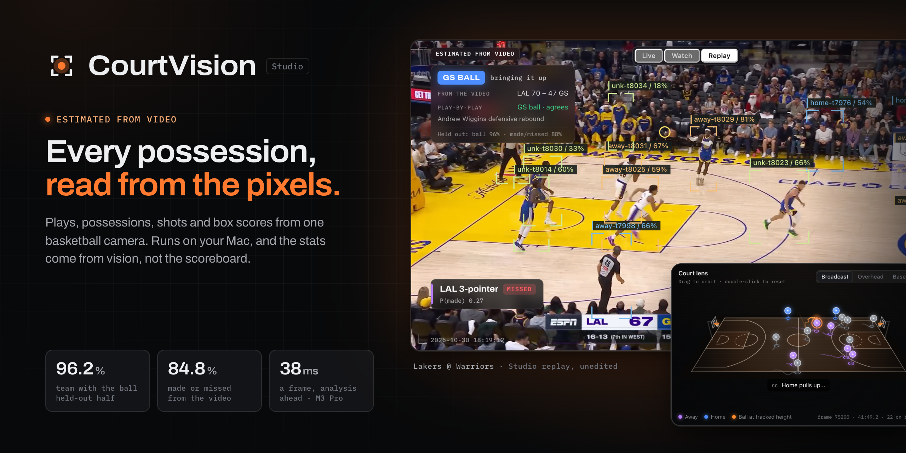

<div align="center">

# CourtVision

**Real-time basketball computer vision, live stats, TypeSafe Jev decision layer, and grounded AI narration with an operator dashboard.**

[Architecture](#architecture) · [Core Capabilities](#core-capabilities) · [Benchmark & Accuracy](#how-accuracy-is-measured) · [Engineering Deep Dives](#engineering-deep-dives) · [Quickstart](#quickstart) · [Limitations](#limitations)

<br/>

[](LICENSE)
[](pyproject.toml)
[](tests/)
[](#architecture)

<br/>



</div>

---

## What It Does

CourtVision converts single-camera basketball video (live HDMI/USB camera, broadcast footage, or high-fidelity simulated feeds) into verified, structured game telemetry in real time. 

The pipeline runs synchronously end-to-end:
```text
video / camera / simulator ─▶ perception ─▶ event engine ─▶ stats ─▶ narration (templates + Claude) ─▶ TTS / captions
   (detect, track, team,        (possession, shots,   (box score, tracking,      ▲
    jersey, homography, ball)    make/miss, rebounds,  xFG, EPV-lite decisions,   │ Jev: play type, moment stakes,
                                  assists, TOs,         insights)                 │ coach-card ranking, Claude line guard
                                  scoreboard reconcile)
```

The stack operates from the Python API, the `courtvision` CLI, and a local video workspace. Upload a recording to follow image-space tracks immediately, then map court landmarks to enable spatial analysis. Simulations exercise the complete event, statistics, and narration pipeline. **NBA broadcast event accuracy remains unmeasured:** simulator scores below do not establish real-game reliability.

---

## Core Capabilities

| Real-Time Perception & Camera Calibration | Deterministic Monocular Event Engine |
| :--- | :--- |
| **Pinhole Geometry & Floor Homography**<br/>Projects 2D image coordinates to standard court coordinates (NBA, FIBA, NCAA, NFHS) via Direct Linear Transform (DLT) and RANSAC. Runs ByteTrack multi-object tracking, Kalman-filtered ball estimation, and configured scorebug OCR. | **Deterministic State Machine**<br/>Estimates possession transitions, shot trajectories, makes, misses, rebounds, and turnovers. Uses temporal evidence, contest-aware backdating and scoreboard deltas; inferred events still require validation. |

| Live Box Score & Advanced xFG / EPV | TypeSafe Jev Decision Engine |
| :--- | :--- |
| **Instant Statistical Aggregation**<br/>Computes traditional box scores, player tracking metrics, spatial shot charts, expected field goal percentage (xFG), and EPV-lite decision grades at sub-frame latency. | **Sub-Second Decision Context**<br/>Queries TypeSafe Jev for play-type classification, leverage and moment stakes, and coach-card insights under strict per-bundle latency budgets with deterministic local fallbacks. |

| Grounded AI Narration & Captions | Closed-Loop Simulator & Learning Flywheel |
| :--- | :--- |
| **Hallucination-Grounded Commentary**<br/>Combines rule-based play-by-play templates with Anthropic Claude color commentary. Every generated sentence is verified against a strict fact-packet grounding validator before emission. | **End-to-End Evaluation & Retraining**<br/>Includes a physics-grounded basketball simulator with configurable sensor noise, broadcast camera tracking, play-by-play alignment, and automated model bundle promotion. |

---

## Architecture

CourtVision decomposes real-time sports telemetry into bounded, testable layers. Frame ingestion runs in an isolated worker thread while the event engine, statistical models, and WebSocket server execute cooperatively on an asynchronous event loop.

```mermaid
flowchart LR
    subgraph Ingest["Frame Ingestion & Sources"]
        Cam["Live Camera (USB/HDMI)"]
        Vid["Video File (.mp4 / .mkv)"]
        Sim["GameSimulator (courtvision/sim)"]
    end

    subgraph Perception["Perception Layer (courtvision/perception)"]
        Det["Object Detector (RF-DETR / ColorBlob)"]
        Tracker["Multi-Object Tracker (ByteTrack)"]
        BallKM["Ball Kalman Filter"]
        Homo["DLT + RANSAC Homography"]
        ScoreOCR["Scoreboard / Scorebug OCR"]
    end

    subgraph Engine["Deterministic Event Engine (courtvision/events)"]
        PossSM["Possession State Machine"]
        ShotRes["Shot Flight & Outcome Resolver"]
        Deadball["Deadball & Whistle Reconciliation"]
    end

    subgraph Analytics["Analytics & Decision"]
        BoxScore["Live Box Score & Lineups (courtvision/stats)"]
        ShotModel["Shot Quality & xFG Model"]
        JevClient["TypeSafe Jev Client (courtvision/decision)"]
    end

    subgraph Output["Narration & Presentation"]
        Narrator["Narration Director (courtvision/narration)"]
        ClaudeNarrate["Claude Color Commentary"]
        FactGuard["Fact-Packet Grounding Validator"]
        Dashboard["FastAPI + WebSocket Live Dashboard"]
    end

    Ingest --> Det
    Det --> Tracker
    Tracker --> BallKM
    Tracker --> Homo
    Det --> ScoreOCR

    Tracker --> PossSM
    BallKM --> ShotRes
    ScoreOCR --> Deadball
    Homo --> PossSM

    PossSM --> BoxScore
    ShotRes --> ShotModel
    Deadball --> BoxScore

    BoxScore --> JevClient
    PossSM --> Narrator
    ShotRes --> Narrator
    JevClient --> Narrator
    Narrator --> ClaudeNarrate
    ClaudeNarrate --> FactGuard
    FactGuard --> Dashboard
    BoxScore --> Dashboard
```



### End-to-End Execution Flow

1. **Frame Capture & Observation**: Decodes the input video's frames; analysis throughput depends on the detector, resolution and hardware. The perception layer infers bounding boxes using RF-DETR or synthetic color-blob detectors. `courtvision/geometry/homography.py` projects player footpoints to court coordinates after calibration.
2. **Multi-Object State Estimation**: `courtvision/perception/tracker.py` links detections across frames using ByteTrack. The ball Kalman filter maintains 3D position and velocity estimates through player and backboard occlusions.
3. **Deterministic Event Classification**: `courtvision/events/engine.py` processes court observations frame-by-frame. The possession state machine detects ball control, passes, strips, and turnovers. Shot arcs are tracked until the ball leaves the rim cylinder, cross-referencing scorebug OCR increments to confirm field goals.
4. **Statistical Aggregation & Decision Layer**: Confirmed events update player box scores, plus/minus, and expected possession value (EPV) in `courtvision/stats/`. The `courtvision/decision/client.py` evaluates play patterns and tactical leverage via TypeSafe Jev within strict 250ms deadline budgets.
5. **Grounded Narration & Streaming**: `courtvision/narration/` synthesizes structured fact packets. In real-time mode, Anthropic Claude generates dead-ball color commentary. The generated line is checked by `GroundingValidator` against the game fact packet before being emitted to WebSockets and TTS engines.

---

## Engineering Deep Dives

### 1. Monocular Ball Occlusion & Contest-Aware Steal Backdating

- **Problem**: In monocular video, the ball's height ($Z$) is unobserved. When a defending player strips an offensive ball-handler in heavy traffic, bounding boxes overlap and the ball is occluded for multiple frames. Tracking ball custody naively stamps turnovers 1.2–2.5 seconds late (once the stealer establishes uncontested open-court control), corrupting player attribution and generating spurious turnover events.
- **Approach**: Implemented contest-aware steal backdating in `courtvision/events/possession.py`. When a change of team possession occurs following a contested state, the engine retroactively evaluates the candidate window across preceding frames (up to `steal_backdate_max_s`). A reachability veto rejects physically impossible steals (e.g. Defender distance $> 6.5\text{ ft}$ at the mark), dating the event back to the first physical disruption point.
- **Why**: Machine learning cue classifiers without temporal backdating frequently confuse deflections, loose balls, and clean steals. Backdating based on reachability and candidate windows matches official scorer attribution while maintaining deterministic state machine guarantees.
- **Tradeoff**: Event emission for contested steals is delayed by up to 400ms while waiting for unambiguous possession confirmation, requiring downstream consumers to accept retrospective event timestamps.

### 2. Planar Homography with Dynamic Scorebug OCR Reconcile

- **Problem**: Monocular camera setups suffer from perspective distortion and physical vibration. Relying solely on visual net deformation to detect made shots produces false positives on airballs that pass close behind the rim.
- **Approach**: Combined a Direct Linear Transform (DLT) with RANSAC homography (`courtvision/geometry/homography.py`) with a dedicated 5Hz scorebug OCR reader (`courtvision/perception/scorebug.py`). Shots entering the rim cylinder enter a `PENDING_CONFIRMATION` state. The event engine watches the scorebug for a 2-point or 3-point delta within a 3.0-second post-shot window.
- **Why**: Confirmed scoreboard changes provide an independent score reference. Reconciling visual shot candidates against those changes can reduce false makes. Zero team-points error in simulator runs does not establish reliable OCR or zero error on real broadcasts.
- **Tradeoff**: Requires the broadcast scorebug to be visible in the camera frame and introduces a 1.0–2.5 second latency before confirming field goals in the official log.

### 3. TypeSafe Jev Decision Integration with Strict Circuit Breakers

- **Problem**: Calling external decision models and LLMs during live game broadcasts creates latency spikes that can stall the 30 FPS perception loop or produce out-of-order commentary if network requests hang.
- **Approach**: Built a fault-tolerant façade (`courtvision/decision/client.py`) utilizing per-bundle deadlines, asynchronous timeouts, and circuit breakers. Each decision request carries an explicit latency budget (e.g. 250ms for live play calls, 1200ms for halftime cards). If the Jev endpoint fails to respond within budget, the engine falls back to deterministic local rule decoders (`courtvision/decision/decoders.py`).
- **Why**: Live sports broadcasting has hard real-time deadlines. Dropping frames or delaying narration to wait for remote cloud inference destroys user experience.
- **Tradeoff**: Under high network latency or API outages, insights fall back to simpler rule-based tactical heuristics rather than deep statistical play classifications.

---

## How Accuracy is Measured

Every simulated game produces exact ground truth: 3D player coordinates, ball trajectories, and independently tallied official box scores (`courtvision/eval/`):

- **Event Matching**: Predicted events are greedily matched to ground truth within a $\pm 1.0\text{ s}$ temporal window ($\pm 0.25\text{ s}$ for dribbles).
- **Core Headline Metric**: Macro-F1 across 9 core event kinds (shot attempts, makes, misses, rebounds, assists, steals, turnovers, blocks, passes).
- **Box Score Evaluation**: Mean Absolute Error (MAE) per stat across all active players and total team points discrepancy.
- **Tracking Accuracy**: Multiple Object Tracking Accuracy (MOTA), Identification F1 (IDF1), and court position Root Mean Square Error (RMSE) in feet.

### Benchmark Evaluation Modes
1. `truth3d`: Ingests perfect 3D coordinates; tests pure event engine and decision logic.
2. `mono`: Introduces sensor noise (position noise, bounding box jitter, ball dropouts, occlusions, and zero height coordinate).
3. `video`: Renders full 1280×720 frames and runs the complete perception stack (RF-DETR / ColorBlob, ByteTrack, homography, template jersey reader, scorebug OCR).

---

## Empirical Benchmark Results

### Round 4 Accuracy Benchmark (2026-10-22)

Error-driven event-engine fixes, tuned on train seeds 1–6 only, each checked by an independent review (rule compliance, overfitting, reproduced numbers), then scored once on the held-out seeds 101–104. "Round start" is commit `5e52881` measured on the same games.

| Mode (s/game) | Train 1–6: round start | Train 1–6: round 4 | Held-out 101–104: round start | Held-out 101–104: round 4 [95% CI] | Held-out verdict |
|---|---|---|---|---|---|
| `truth3d` (1200) | 0.967 | **0.996** | 0.941 | **0.970** [0.960, 0.980] | +0.029, outside the CI |
| `mono` (1200) | 0.751 | **0.829** | 0.708 | **0.742** [0.696, 0.780] | +0.034, outside the CI |
| `video` (180) | 0.806 | **0.892** | 0.636 | **0.650** [0.575, 0.934] | +0.014, noise (180 s games) |

- **What changed**:
  - `truth3d`: a shot rises to about rim height; a throw-in restarts play when a player on the court gains it; a ring bounce between two frames is not a block; the score reconciler waits a moment before flipping a miss.
  - `mono` / `video`:
    - blocks: committed only once the ball's next owner shows it was knocked loose, with image-speed, touch-margin and head-line gates;
    - steals: a gain long after the release is a loose-ball recovery, and only a dribble in the holder's hands corroborates control;
    - passes: a pass crossing a teammate's box in flight is one pass;
    - shots: a miss the ball went back to the rim after is not flipped by the score (an unseen putback is inferred instead);
    - dribbles: measured as the ball's height above the dribbler's feet, so drives towards or away from the camera keep their bounces;
    - rebounds: hidden holds, catches out of view and loose balls crossing a body.
- **Generalisation**: the `truth3d` gain carries over to the held-out games; the monocular gain only partly (+0.079 on train, +0.034 held-out). The six train games hold few rare events (23 blocks, 28 steals), so fixes to single plays fit them.
- **Held-out `mono` per kind**: steals 0.50, turnovers 0.68, blocks 0.27 (8 truth events), rebounds 0.73, assists 0.81, missed shots 0.89, passes 0.91.
- **Targets** (`mono` and `video` ≥ 0.85, `truth3d` ≥ 0.98) are **not met** on held-out games.
- Held-out reports (aggregate only): [`docs/bench/round4_heldout_before_5e52881.md`](docs/bench/round4_heldout_before_5e52881.md), [`docs/bench/round4_heldout_after_ffe5129.md`](docs/bench/round4_heldout_after_ffe5129.md).

### Round 3 Accuracy Benchmark (1200-Second Games)

Evaluated across train seeds (1–6) and held-out test seeds (101–104) with deterministic random seeds:

| Split (Seeds, Duration) | Mode | Session Baseline | Round 3 | Delta (95% Bootstrap CI) |
|---|---|---|---|---|
| **Train** (Seeds 1–6, 1200s) | `truth3d` | 0.949 | **0.967** | +0.018 |
| **Train** (Seeds 1–6, 1200s) | `mono` | 0.738 | **0.751** | +0.013 |
| **Held-Out** (Seeds 101–104, 1200s) | `truth3d` | 0.916 | **0.941** | +0.025 |
| **Held-Out** (Seeds 101–104, 1200s) | `mono` | 0.697 | **0.708** | +0.010 |

*Note: Video mode (rendering frames + perception stack, 180s) achieved **0.740** headline F1 on train seeds (seed mean 0.796) and **0.636** on held-out seeds (seed mean 0.704, MOTA 0.971, identity accuracy 0.976). Correction (round 4): the 0.740 train figure was measured before the last round-3 commits; the round-3 final commit `5e52881` scores 0.806 on the same games.*

### Realism Pass Baseline (300-Second Games, Seeds 1–6)

| Mode | Headline F1 (Pooled) | Micro F1 | FG Make/Miss | Rebound F1 / Attr | Assist F1 / Label | Box MAE |
|---|---|---|---|---|---|---|
| `truth3d` | **0.953** [0.869, 0.997] | 0.988 | 1.000 (n=83) | 1.000 / 0.945 | 0.976 / 1.000 | 0.015 |
| `mono` | **0.553** [0.536, 0.573] | 0.814 | 0.987 (n=78) | 0.642 / 0.600 | 0.800 / 0.655 | 0.113 |

### System Latency & Performance Profile

Re-measured on 2026-10-26 with `simulate --seconds 120 --seed 7 --mode truth3d`, Jev off,
template narration. This is an **offline synthetic run**, not RF-DETR throughput or live broadcast latency.

| Measurement | Result |
|---|---|
| Complete frame step | p50 0.1 ms, p95 0.5 ms (3,600 frames) |
| 120 source seconds | 0.9 s processing wall time (128.6×; excludes pre-simulation) |
| Event occurrence → engine emission | p50 66.7 ms, p95 833.3 ms (155 events) |
| Engine emission → narration | p50 233.3 ms, p95 931.7 ms (18 matched lines) |
| Event occurrence → narration | p50 650.0 ms, p95 3160.0 ms (18 matched lines) |
| Synthetic video perception (same seed/duration, 1280×720) | p50 28.5 ms, p95 41.5 ms (3,600 frames) |
| Complete synthetic video run | 120 source seconds in 114.5 s processing wall time; includes rendering and perception |

The studio displays vision-stage time and inference rate (excluding decoding and UI) for the loaded footage. It processes
every frame; slower hardware can fall behind source time. RF-DETR Nano starter detections were exercised
on the [Supervision basketball sample](https://supervision.roboflow.com/latest/assets/), without a labelled
event-accuracy evaluation. See [video workspace validation](docs/STUDIO.md) for the exact scope.

### Round 5 held-out verification

One aggregate check on seeds 101–104, after integrating `425a779`:

| Mode | Source seconds per game | Headline F1 | 95% seed-bootstrap CI |
|---|---:|---:|---:|
| `truth3d` | 1200 | **0.991** | 0.982–1.000 |
| `mono` | 1200 | **0.815** | 0.775–0.873 |
| `video` | 180 | **0.792** | 0.733–0.837 |

Truth3d exceeds the 0.98 simulator target; mono and video remain below 0.85. The round-5 simulator
adds pump fakes and changes the generated games, so these figures are not a controlled before/after
comparison with round 4. [Complete aggregate report](docs/bench/round5-heldout.md).

### NBA broadcast accuracy

Measured on one real game so far, Lakers @ Warriors (2024-12-25, ESPN), against the ESPN box score and
play-by-play (research use; how it works: [docs/NBA.md](docs/NBA.md)). Measurements of 2026-10-29:

| What | Result | Measured on |
|---|---|---|
| Ball found within 15 px | **95.7%** (3.5% wrong, 0.8% missed); earlier student 88.3%, RF-DETR Nano starter 25.8% | 256 labelled frames of held-out teacher clips |
| Court registration, no clicks | 22,160 of 26,103 Q1 frames tracked (most of the rest are replays, close-ups and cut-aways) | first quarter |
| Points, field goals made, threes made | exact for both teams (from the scorebug) | first quarter and the full scorebug scan |
| Box score, 13 stats x 2 teams | sum of absolute count errors / sum of true counts: 0.305 before the fusion work, **0.068** after (13 of 190 counts off) | first quarter: **in-sample**, the quarter the fusion rules were developed on |

Held-out quarters (Q2-Q4, never used for tuning) and further games are the real test; `tools/nba_loop.py` records
every evaluation in `runs/nba/leaderboard.jsonl`.

---

## Quickstart

### On a Mac: double-click

Double-click **`Start CourtVision.command`** in the repo folder. The first time, it:

1. finds Python 3.11+ (or offers to install 3.12 with Homebrew or [uv](https://docs.astral.sh/uv/)),
2. creates `.venv` and installs CourtVision with the video-analysis extras (about 1-2 GB, mostly PyTorch),
3. asks for your Anthropic and TypeSafe API keys (both optional, input hidden) and saves them in the
   macOS login Keychain under "CourtVision", never in the repo or a dotfile,
4. offers to add **CourtVision** to `~/Applications` so you can start it from Spotlight, Launchpad or the Dock.

Later launches skip straight to the Studio, reinstall only when `pyproject.toml` changes, and just reopen
the browser tab if the Studio is already running. Close the Terminal window to stop it.
Run `scripts/mac/courtvision.sh keys` to replace or remove keys, `scripts/mac/courtvision.sh setup` to
reinstall, and `scripts/mac/courtvision.sh install-app` if you move the repo folder.

### Manual install

Python 3.11 or newer (this workspace uses 3.12).

```bash
# Create and activate virtual environment
python3 -m venv .venv
source .venv/bin/activate

# Install package in editable mode with development dependencies
pip install -e ".[cv,dev]"
```

### Open a game video

```bash
courtvision studio --open
```

On a Mac, double-click **`Start CourtVision.command`** instead. The workspace opens at
[localhost:8000](http://127.0.0.1:8000/).

1. Choose **Open video**, select an MP4, MOV, MKV or AVI (up to 8 GB), and start analysis.
   The first run prepares an RF-DETR Nano COCO starter checkpoint (about 350 MB). The footage stays local.
2. Watch player/ball overlays on the actual processed frame. Pause, resume, adjust speed, or expand the monitor.
3. Use **Court setup** to freeze a frame and mark at least four known floor landmarks. The reference diagram
   identifies the selected point. Apply setup and resume; setup is saved with this video.
4. Review the play-by-play and box score. Use **Game controls** for score, lineup, and event corrections.
   **Export analysis** downloads the current events, stats, transcript, and timing report as JSON.

**Explore the demo** runs a clearly labelled simulated game without downloading a detector. Recent footage
can be reopened; previous run outputs stay in separate `runs/studio/analyses/` folders.

The starter model detects generic people and sports balls. It does not automatically identify NBA players,
read arbitrary TV scorebugs, distinguish every replay, or produce official statistics. A basketball-trained
checkpoint, validated identity/scoreboard setup, and labelled real-game evaluation are still needed for that.
Jev and Claude are optional; missing keys leave local rule-based decisions and template commentary available.

### Running the Stack

1. **Simulate a game and score against ground truth**:
   ```bash
   courtvision simulate --seconds 120 --mode truth3d
   ```

2. **Launch live WebSocket dashboard with a simulated game**:
   ```bash
   courtvision serve --speed 2 --tts none --open
   ```
   Open [http://127.0.0.1:8765/](http://127.0.0.1:8765/) to view the real-time top-down court, event feed, live box scores, shot charts, and coach insights.

3. **Render synthetic video and score through perception**:
   ```bash
   courtvision render --seconds 60 --out runs/demo.mkv
   courtvision run --video runs/demo.mkv \
       --calibration runs/demo.calibration.json \
       --roster runs/demo.roster.yaml \
       --scoreboard-roi runs/demo.scoreboard_roi.json \
       --detector colorblob \
       --out runs/demo-run
   courtvision eval runs/demo-run --truth runs/demo.truth_events.jsonl
   ```

4. **Calibrate and run custom venue footage**:
   ```bash
   # Calibrate court from 4 floor landmark coordinates
   courtvision calibrate my_points.json --out venue.json

   # Install computer vision extras (RF-DETR, supervision, ByteTrack)
   pip install -e ".[cv]"

   # Run offline on pre-recorded footage
   courtvision run --video game.mp4 --calibration venue.json \
       --roster docs/examples/roster.yaml \
       --detector rfdetr:weights/basketball.pth

   # Stream from live camera
   courtvision serve --source camera --camera 0 --calibration venue.json --roster docs/examples/roster.yaml
   ```

---

## Command Reference

| Command | Purpose | Key Arguments |
|---|---|---|
| `studio` | Upload footage and follow local video analysis | `--open`, `--port`, `--data-dir`, `--config`, `--auth-token` |
| `simulate` | Evaluates simulator game against ground truth | `--seconds`, `--seed`, `--mode (truth3d\|mono\|video)`, `--out`, `--jev` |
| `serve` | Runs FastAPI server and live dashboard | `--source (sim\|video\|camera)`, `--speed`, `--host`, `--port`, `--tts`, `--open` |
| `run` | Processes offline video file through CV stack | `--video`, `--calibration`, `--detector`, `--roster`, `--scoreboard-roi`, `--out` |
| `calibrate` | Computes DLT homography from floor coordinates | `points_file.json`, `--out`, `--from-sim` |
| `render` | Generates synthetic broadcast video with truth sidecars | `--seconds`, `--out (.mp4\|.mkv\|.avi)`, `--broadcast` |
| `eval` | Scores predicted `events.jsonl` against truth | `run_dir`, `--truth`, `--json` |
| `config` | Displays effective YAML runtime configuration | `--section`, `--default` |
| `latency` | Measures live network latency against Claude and Jev | `--harness` |

---

## Technology Stack

### Perception & Computer Vision
- **Object Detection**: RF-DETR (PyTorch / CoreML), Color-Blob synthetic detector
- **Tracking & Geometry**: ByteTrack, Kalman Filters, DLT + RANSAC planar homography
- **Video Processing**: OpenCV, FFV1 lossless codec, H.264
- **Scoreboard Extraction**: OCR region-of-interest reader and template scorebug parser

### Core Event & Analytics Engine
- **State Estimation**: Deterministic finite-state machine with contest-aware backdating
- **Geometry & Rules**: Rule specifications for NBA, FIBA, NCAA, and NFHS court dimensions
- **Analytics Models**: Real-time Box Score aggregator, Shot Quality Model (xFG), EPV-lite decision grades

### Decision & AI Orchestration
- **Decision Engine**: TypeSafe Jev client with per-bundle circuit breakers and deadline management
- **Narration**: Claude 3.5 / 5.5 narration director with strict Fact-Packet grounding validation
- **Speech Synthesis**: macOS AVSpeech synthesizer, template-driven audio fallback

### Application Server & UI
- **Server**: FastAPI, Uvicorn, Asynchronous WebSockets
- **Dashboard**: HTML5 Canvas top-down court visualization, responsive event stream, real-time stat cards

---

## Repository Structure

```text
courtvision/
├── courtvision/                 # Primary Python package
│   ├── geometry/                # Court dimension specs (NBA, FIBA, NCAA) and DLT homography
│   ├── perception/              # RF-DETR, ByteTrack, court tracker, scorebug OCR, ball Kalman
│   ├── events/                  # Deterministic event state machine (possession, shots, deadball)
│   ├── stats/                   # Box score, shot quality xFG, advanced metrics, lineup tracking
│   ├── decision/                # TypeSafe Jev API client, circuit breakers, and advisor façade
│   ├── narration/               # Fact packets, Claude line director, grounding validator, TTS
│   ├── sim/                     # Seeded game simulator, noise model, synthetic video renderer
│   ├── eval/                    # Macro-F1 benchmark scoring, tracking metrics, box score MAE
│   ├── learning/                # Closed-loop flywheel: ingest, train candidate bundles, promote
│   ├── server/                  # FastAPI web server, WebSocket hub, and live browser dashboard
│   ├── config.py                # Hierarchical YAML configuration loader
│   ├── pipeline.py              # Offline and real-time execution pipelines
│   └── cli.py                   # Unified command-line interface entrypoint
├── docs/                        # Technical documentation and research reports
│   ├── ARCHITECTURE.md          # Formal module contracts and event semantics
│   ├── RESEARCH.md              # Research survey, legal considerations, and design bindings
│   ├── TRAINING.md              # Fine-tuning guides, data licensing, and rights gates
│   └── examples/                # Sample roster files and camera calibration points
├── tests/                       # Automated offline and integration tests
├── tools/                       # Multi-seed accuracy benchmark runner (`accuracy_bench.py`)
├── .env.example                 # Environment variable template for optional API keys
└── pyproject.toml               # Python package specification and optional dependency groups
```

---

## Verification & Testing

CourtVision has 2,075 deterministic, network-free tests (6 more skip when optional extras are missing; 3 strict expected failures document known monocular limitations):

```bash
# Run the complete test suite
.venv/bin/python -m pytest -q

# Run integration and CLI verification suites
.venv/bin/pytest tests/test_integration_cli_commands.py -q
.venv/bin/pytest tests/test_integration_core_video.py -q

# Run multi-seed accuracy benchmark (train seeds 1-6)
.venv/bin/python tools/accuracy_bench.py --modes truth3d,mono --split train --seconds 300
```

---

## Limitations

- **Simulator-Scored Baseline**: Current benchmark numbers are derived from the seeded simulator and synthetic renderer. Accuracy on arbitrary in-the-wild handheld footage is unmeasured.
- **Starter detector and NBA broadcasts**: Upload/playback, generic detections and manual court setup are usable locally. Automatic NBA identity, scorebug OCR and replay recognition are not validated. Ball occlusion, camera changes and tiny broadcast balls can suppress or misclassify events. The studio's statistics are estimates for review.
- **Fixed-Camera Assumption**: The homography model assumes a fixed camera position or a calibrated pan/tilt/zoom head with fixed center. Unconstrained dynamic camera motion breaks the planar homography.
- **Monocular Occlusion Challenges**: In single-camera footage without stereoscopic height estimation, steals, turnovers, and blocks remain challenging (held-out mono F1, round 4: steals 0.50, turnovers 0.68, blocks 0.27). One camera cannot tell a ball high over the shooter from one in the box of a player behind him on the same camera ray, nor a pump fake that draws a defender's jump from a shot he turns back (both recorded as strict expected-failure tests); the hold-time block path for a shot swatted straight back into the shooter's hands is therefore off by default (`hold_block_confirm_s`).
- **Video Compression Artifacts**: Lossy H.264 compression degrades ball detection accuracy compared to lossless FFV1 encoding.
- **Operator-Assisted Events**: Fouls, timeouts, and player substitutions require manual operator confirmation from the dashboard or a live feed; they are not inferred purely from computer vision.

---

## License

This project is licensed under the terms of the [MIT License](LICENSE).
