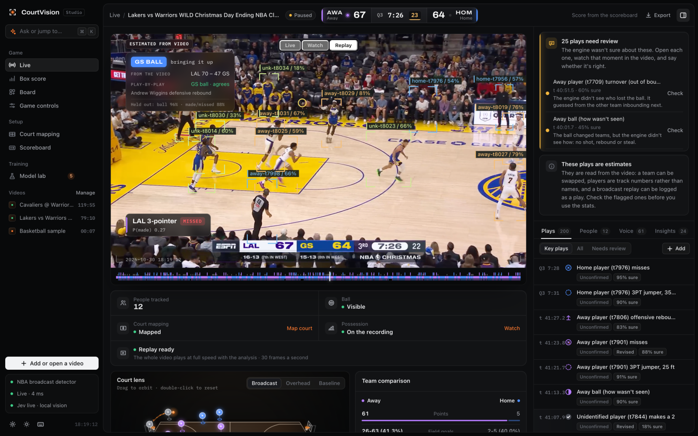
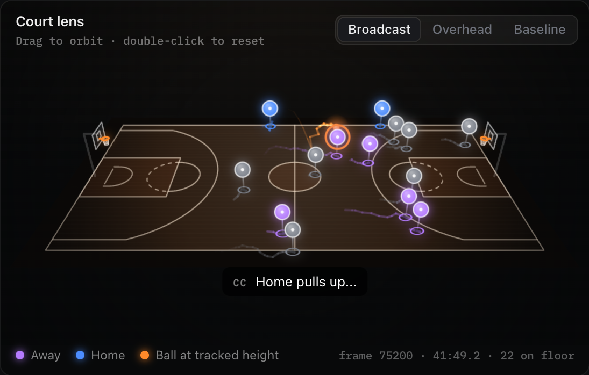
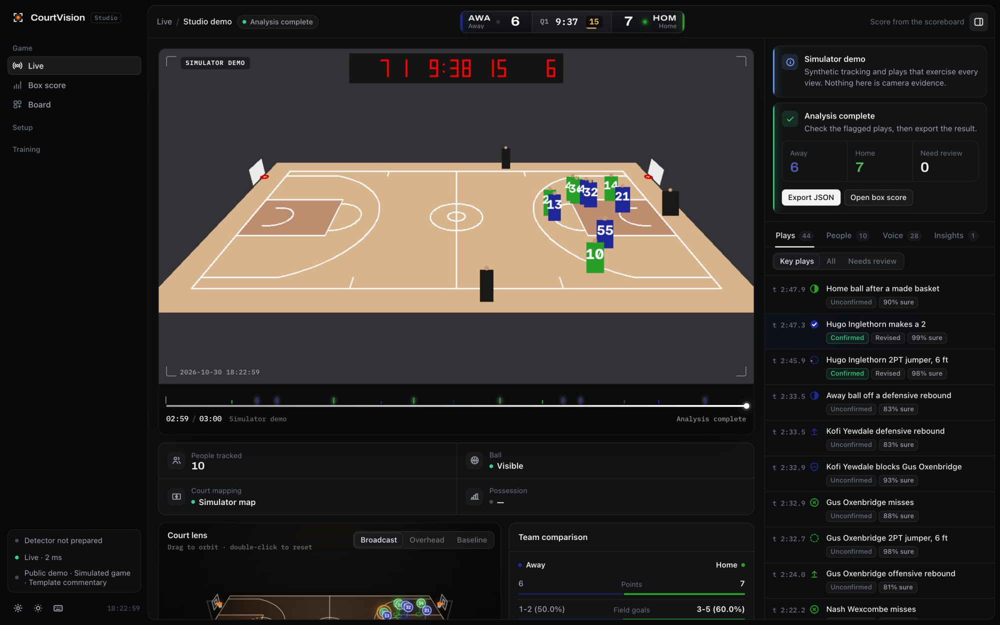
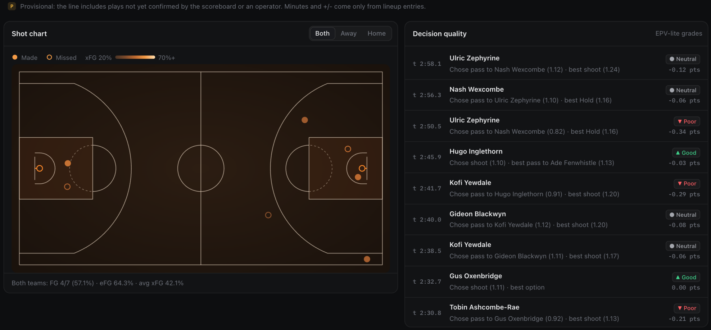
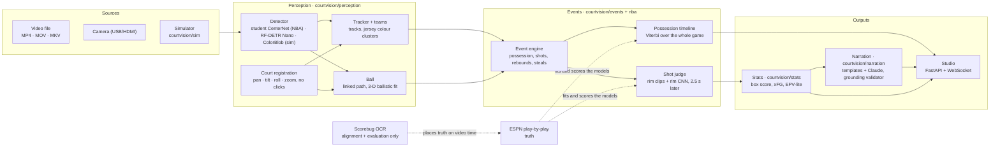

<div align="center">

# CourtVision

**Turns basketball video into plays, possessions and box scores, on your own Mac, from the pixels alone.**

[Live demo](https://courtvision-beta.vercel.app) · [How it works](#how-it-works) · [Results](#results-on-real-nba-broadcasts) · [Engineering](#interesting-engineering) · [Quickstart](#quickstart) · [Limits](#limitations)

[](LICENSE)
[](pyproject.toml)
[](#verification)
[](https://courtvision-beta.vercel.app)

<br/>


</div>

---

## What it does

CourtVision watches a single-camera basketball video (an NBA broadcast, your own recording, a USB camera, or its own
simulator) and produces a structured game: who had the ball, every shot with a made/missed call and a probability,
rebounds, steals, turnovers, a box score, shot charts and short commentary. It runs locally: footage stays on the machine
unless you opt into the research tool that sends rim crops to TypeSafe Jev.

The working rule is **stats from vision, not from the scoreboard.** A broadcast scorebug would make the points exact
by reading them, and hide how weak the vision is. CourtVision uses the scorebug only to place the official
play-by-play on video time, so that every number can be scored against the truth.

**Maturity:** a working research system. The Studio, simulator and evaluation harness run end to end; real-broadcast
accuracy is measured on two NBA games so far, and the numbers below say exactly where it falls short.

## What you get

The Studio is the app: a local web workspace served by `courtvision studio`.



<sub>The Studio replaying its own analysis of a real broadcast (Lakers @ Warriors, 2024-12-25, ESPN). Boxes are the
detector's tracks with confidence; <b>GS BALL</b> is the team with the ball decided from the video, here agreeing with
the play-by-play; the card at the bottom left is a shot the engine saw and judged missed. The top-bar score is read from
the broadcast scorebug for reference only. Unedited screenshot, 2026-10-30.</sub>

- **Open a game video** (MP4, MOV, MKV or AVI, up to 8 GB). For NBA broadcasts the Studio detects, tracks and maps the
  court with no clicks; for other venues you match four floor landmarks once.
- **Three ways to watch.** **Live** analyses as it plays; **Replay** plays an analysis prepared in the background at
  full speed with seeking; **Watch** draws the whole-game possession analysis over the original video and sound.
- **Plays you can check.** Each play the engine was unsure of says why ("the ball changed teams, but the engine
  didn't see how") and has a **Check** button; checked plays count as confirmed.
- **Ask** (`⌘K`) answers questions about the game as live cards you can pin to a board.

| Court lens on the broadcast | Simulator with exact ground truth |
| :--- | :--- |
| The mapped floor in perspective: players on their court position, the ball at its tracked height with a floor shadow, so a shot reads as an arc. Orbit it, or switch to the overhead or baseline camera. | A seeded simulator renders a synthetic broadcast with every position, ball flight and box-score line known, so each engine change is scored on games it was not tuned on. Its players have generated names. |
|  |  |



<sub>Shot chart (made and missed, coloured by expected field-goal percentage) and EPV-lite grades of each pass-or-shoot
decision, from the simulated demo game. The same views fill in on real broadcasts, where players are track numbers
(see <a href="#limitations">Limitations</a>).</sub>

---

## How it works



1. **Detect.** For NBA broadcasts a ResNet-18 CenterNet student ([`perception/student.py`](courtvision/perception/student.py))
   sees the current frame plus the two before it, so a motion-blurred ball stands out. It was distilled from an
   RF-DETR teacher on broadcast footage and runs on Apple's Neural Engine through Core ML.
2. **Register the court.** [`perception/broadcast_court.py`](courtvision/perception/broadcast_court.py) estimates the
   main camera's position once per game, then fits only pan, tilt, roll and zoom per frame. A worker process does this
   ahead of the frame being analysed ([`perception/court_worker.py`](courtvision/perception/court_worker.py)).
3. **Track the ball and players.** One ball path is linked through the per-frame candidates by dynamic programming,
   with the camera's own turn subtracted from the motion cost. Ballistic stretches are fitted in 3-D, where gravity
   supplies the depth one camera cannot see ([`perception/ball3d.py`](courtvision/perception/ball3d.py)).
4. **Read the plays.** The event engine ([`events/engine.py`](courtvision/events/engine.py)) turns frame states into
   possessions, shots, rebounds, steals and turnovers under configurable NBA, FIBA, NCAA or NFHS rules. The shot judge
   ([`nba/live_judge.py`](courtvision/nba/live_judge.py)) re-decides each make or miss from evidence at the rim, and
   the possession timeline ([`nba/timeline.py`](courtvision/nba/timeline.py)) decides who had the ball over the whole
   game at once.
5. **Report.** Stats, the box score and xFG come from the event log ([`stats/`](courtvision/stats/)). Optional layers
   add TypeSafe Jev play context and Claude commentary, both behind deterministic fallbacks. The Studio
   ([`server/studio.py`](courtvision/server/studio.py)) streams all of it to the browser.

Module contracts and event semantics: [docs/ARCHITECTURE.md](docs/ARCHITECTURE.md). The broadcast pipeline stage by
stage: [docs/NBA.md](docs/NBA.md).

---

## Results on real NBA broadcasts

Two games so far: Lakers @ Warriors (2024-12-25, ESPN, 1080p) and Cavaliers @ Warriors (2017 Finals Game 5, ABC,
720p). Every number below is from the video alone (no scorebug evidence) and **held out**: fitted on one half and
scored on the other, or fitted on one game and scored on the other.

| What | Result | Held out how |
|---|---|---|
| Team with the ball, settled live play | **96.2%** (event engine alone 73.6%); second game **75.8%** | half vs half, per game |
| Made or missed, real shots | **84.8%** from the video, **87.6%** adding TypeSafe Jev on rim crops | half vs half, Lakers @ Warriors |
| Made or missed, Studio shot judge across games | **84.0% / 77.8%** vs the engine's own 83.3% / 68.9% | each game judged by models fitted on the other |
| Studio made-shot F1 | **0.32 → 0.81** after moving the call from the scorebug to the rim | a 10-minute stretch the judge was not fitted on |
| Ball found within 15 px | **95.7%** (RF-DETR Nano starter: 25.8%) | 256 labelled held-out frames |
| Court registered, no clicks | 22,160 of 26,103 first-quarter frames tracking; 3,726 without the court (out of view or not found) | Lakers @ Warriors Q1 |

Gains shrink across games, and the second game exposes failures the first did not (see [Limitations](#limitations)).
More, varied games are the main lever. All tables, including the simulator rounds:
[docs/BENCHMARKS.md](docs/BENCHMARKS.md).

**Simulator, held-out seeds 101–104** (macro-F1 over 9 event kinds, [report](docs/bench/round5-heldout.md)):
`truth3d` (perfect 3-D positions) **0.991**, `mono` (one camera, noise, no ball height) **0.815**, `video` (rendered
frames through the full perception stack) **0.792**. The 0.85 target for `mono` and `video` is not met.

---

## Interesting engineering

### 1. Made shots judged at the rim, not on the scoreboard

- **Problem.** The engine used to wait for the scorebug to confirm a make. In the Studio's replay of Lakers @ Warriors
  that matching failed: 30 makes the camera had seen became misses, and the first 36 minutes showed 17 makes against
  about 45 real ones.
- **Approach.** The shot judge looks again 2.5 s after each call. [`nba/rim_clips.py`](courtvision/nba/rim_clips.py)
  cuts 2.4 s clips that follow the rim through pans and zooms, so the rim is the same size and place in every frame.
  Ball-candidate zones (above, at the ring, in the net, beside) and a ResNet-18 rim model
  ([`nba/rim_model.py`](courtvision/nba/rim_model.py), frame differences as motion input) feed a logistic model
  fitted on the play-by-play, which keeps or overturns the engine's call.
- **Why.** Reading points off the scorebug makes them exact while hiding how weak the vision is, and it breaks on any
  broadcast whose bug differs. Rim evidence uses every ball candidate, so a ball the net hides from the tracker still
  counts.
- **Tradeoff.** Results arrive 2.5 s late. Within a game the rim CNN is right about 85% of the time, across games
  about 69%: two games are too few to generalise.

### 2. Possession decided once per game, not frame by frame

- **Problem.** The engine's holder tracker decides possession greedily with votes and hysteresis over 67 hand-set
  thresholds. One wrong flip becomes a phantom steal and turnover; at settled moments it had the wrong team 9 times
  out of 40, and steals scored an F1 of 0.06.
- **Approach.** [`nba/timeline.py`](courtvision/nba/timeline.py) decodes the whole game at once with Viterbi (the most
  likely sequence of states given all the evidence) from where the camera aims, the engine's shot results and
  rebounds, 3-D ball flights at the rim and the 8-second back-court rule. Which basket each team attacks, and the swap
  at half time, also come from the video. Its settings are fitted on aligned play-by-play.
- **Why.** A broadcast camera follows the ball, so its aim is strong evidence spread over seconds; a sequence model
  can weigh that, and a per-frame vote cannot.
- **Tradeoff.** It needs the whole game, so it runs offline or on the Studio's background analysis, not on the live
  frame. 96.2% on the game it was built on drops to 75.8% on the second, after its team clusters are refitted.

### 3. Click-free court registration for a broadcast camera

- **Problem.** Mapping the court needs a homography (image-to-floor projection) per frame, and the broadcast camera
  pans, zooms and cuts to close-ups and replays. Asking the user to click four landmarks per shot is unusable.
- **Approach.** The main NBA camera sits high at half court and only rotates and zooms, so its centre is solved once
  per game and each frame fits four parameters. Lines are found with top-hat and black-hat filters, candidates are
  scored by bidirectional, orientation-aware chamfer matching, and re-acquisition accepts only a camera the game
  camera could physically be ([`perception/court_search.py`](courtvision/perception/court_search.py)).
- **Why.** One-way matching was fooled by a zoomed-out court squeezed onto the crowd. The physical gate also
  rejects close-ups and replays, which doubles as the signal that play is not live.
- **Tradeoff.** It assumes the standard half-court camera. In the 2017 game a crowd in yellow shirts fools the floor
  mask, and the court is found on only about half the frames.

**Speed without changing results.** On an M3 Pro the Studio's analysis went from 118–164 ms a frame to
46–55 ms, and its background analysis to 38 ms.
Every speed-up except one was checked bit for bit against the previous commit on the same frames. The exception, the
detector on the Neural Engine, kept the same held-out ball F1 (0.9608).
[docs/research/analysis_speed.md](docs/research/analysis_speed.md).

**Grounded commentary.** Claude (`claude-opus-5-5`) proposes commentary lines, and a deterministic validator
([`narration/validator.py`](courtvision/narration/validator.py)) rejects any sentence whose numbers, scores, names or
claims are not in the game's fact packet. Templates take over without a key. TypeSafe Jev calls carry hard per-bundle
deadlines (0.7–1.5 s) and a circuit breaker that falls back to local rule decoders.

---

## Technology

| Layer | Used for |
|---|---|
| **Vision** | PyTorch, Core ML (Neural Engine), RF-DETR, `supervision` + `trackers`, OpenCV, Apple Vision OCR (Swift helper) |
| **Modelling** | NumPy / SciPy: dynamic-programming ball linking, Viterbi possession decoding, logistic shot models, ResNet-18 rim model |
| **Engine and stats** | Pure-Python event state machine, rule sets for NBA / FIBA / NCAA / NFHS, xFG and EPV-lite |
| **AI layers (optional)** | Anthropic SDK (Claude narration and Ask), TypeSafe SDK (Jev play context) |
| **App** | FastAPI, Uvicorn, WebSockets; dependency-free JavaScript and Canvas front end |
| **Delivery** | macOS launcher with Keychain key storage; Docker image for the public demo on Vercel |

---

## Quickstart

### On a Mac: double-click

Double-click **`Start CourtVision.command`**. The first run finds Python 3.11+ (or offers to install it), creates
`.venv`, installs CourtVision with the video extras (1–2 GB, mostly PyTorch), asks for optional Anthropic and TypeSafe
keys and stores them in the macOS Keychain, then opens the Studio at
[127.0.0.1:8000](http://127.0.0.1:8000/). Later launches go straight to the Studio.

### Manual install

```bash
python3 -m venv .venv
source .venv/bin/activate
pip install -e ".[cv,dev]"
courtvision studio --open
```

**Run the demo game** plays a simulated game with no downloads. **Add or open a video** analyses your own footage:
the first run fetches an RF-DETR Nano starter checkpoint (about 350 MB) that detects generic people and balls. For
an unknown venue, match four floor landmarks in **Court mapping**. Press `⌘K` to ask about the game or run any
command. The [Studio guide](docs/STUDIO.md) covers every view.

To analyse a full NBA broadcast and score it against ESPN, follow [docs/NBA.md](docs/NBA.md):

```bash
.venv/bin/python tools/nba_new_game.py "/path/to/recording.mp4"
.venv/bin/python tools/nba_loop.py run --game <YYYY-MM-DD-AWY-HOM>
```

The NBA student detector, rim model and shot models are trained locally from your own footage and are not
distributed with the repository (footage and weights are git-ignored; see [docs/TRAINING.md](docs/TRAINING.md)).

### Configuration

Every key is optional. Without them, decisions use local rules and commentary uses templates.

| Variable | Purpose |
|---|---|
| `ANTHROPIC_API_KEY` | Claude commentary and Ask answers (billed requests) |
| `TYPESAFE_API_KEY` | TypeSafe Jev play context and rim-crop answers |
| `COURTVISION_TOKEN` | Bearer token required when serving beyond localhost |

Copy [`.env.example`](.env.example), or store keys in the Keychain with `scripts/mac/courtvision.sh keys`.
`courtvision config` prints the effective YAML configuration
([`courtvision/config/default.yaml`](courtvision/config/default.yaml)).

### Command line

| Command | Does |
|---|---|
| `courtvision studio` | Opens the local video workspace (`--public-demo` for the watch-only showcase) |
| `courtvision simulate` | Simulates a game and scores the engine against its truth (`--mode truth3d\|mono\|video`) |
| `courtvision serve` | Live dashboard over a simulator, video file or camera |
| `courtvision render` / `run` / `eval` | Renders synthetic video, runs perception on a file, scores `events.jsonl` |
| `courtvision calibrate` | Builds a court homography from floor landmarks |
| `courtvision ingest` / `train` / `promote` | Learning loop: aligned datasets, candidate bundles, promotion on gold games |

---

## Repository structure

```text
courtvision/
├── courtvision/
│   ├── perception/     # detectors, tracker, court registration, ball, teams, scorebug OCR
│   ├── events/         # event engine: possession, shots, dead balls, reconciliation
│   ├── nba/            # broadcast pipeline: possession timeline, shot models, shot judge, rim model, ESPN truth
│   ├── stats/          # box score, lineups, xFG, EPV-lite decision grades, insights
│   ├── geometry/       # court specs per rule set, camera model, homography
│   ├── decision/       # TypeSafe Jev client, deadlines, circuit breakers, local fallbacks
│   ├── narration/      # fact packets, templates, Claude director, grounding validator, TTS
│   ├── sim/            # seeded game simulator and synthetic broadcast renderer
│   ├── eval/           # event F1, tracking metrics, box-score error, benchmark runner
│   ├── training/       # teacher labels, student training, play-by-play alignment, cue models
│   ├── learning/       # ingest → train → promote loop
│   ├── server/         # FastAPI app, Studio, WebSocket hub, static front end
│   └── config/         # default.yaml and per-league rule sets
├── tools/              # research CLIs: nba_analyze, nba_loop, rim and shot models, benchmarks
├── tests/              # pytest suite and Node tests for the replay client
├── docs/               # architecture, NBA pipeline, Studio guide, training, benchmarks, research notes
├── scripts/mac/        # launcher behind Start CourtVision.command
└── Dockerfile          # public watch-only demo image (Vercel)
```

---

## Verification

```bash
.venv/bin/python -m pytest -q                       # 2,574 tests, network-free
node --test tests/js/replay.test.cjs                # replay client, no npm dependencies
.venv/bin/python tools/accuracy_bench.py --modes truth3d,mono --split train --seconds 300
```

Tests for optional backends skip when their extras are not installed. Three strict expected failures document known
single-camera limits (below).

---

## Limitations

- **Two games.** Real-broadcast numbers come from two NBA games, and they drop across games. Treat Studio stats as
  estimates to review: each uncertain play is flagged with its reason.
- **Players are track numbers.** On broadcasts the Studio does not identify players by name, and team assignment
  can drift. In the hero screenshot's replay the live team comparison credited 61 of 66 points to one team while the
  scoreboard read 67–64, and the possession panel's "from the video" score (70–47) is well off; the whole-game
  timeline and shot models above are the stronger path.
- **One camera.** Without depth, a ball high over the shooter and one in front of a player behind him look alike, as
  do a pump fake and a shot. Held-out simulator F1 stays low for blocks and steals.
- **Speed.** Live analysis of 1080p broadcasts runs below real time on an M3 Pro (0.6–0.72× measured); **Replay**
  prepares the full analysis in the background instead.
- **Fouls, timeouts and substitutions** come from the operator, not from vision.
- **Footage rights.** NBA footage and statistics are used for research and evaluation only; they are not shipped,
  and the public demo runs the simulator alone with no API keys ([docs/DEPLOY_VERCEL.md](docs/DEPLOY_VERCEL.md)).

---

## License

[MIT](LICENSE).
